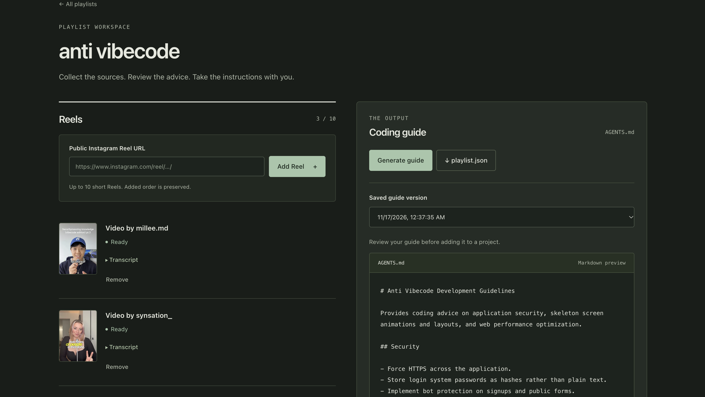
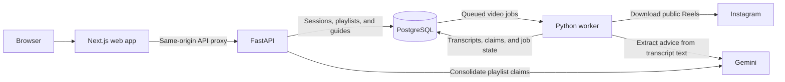
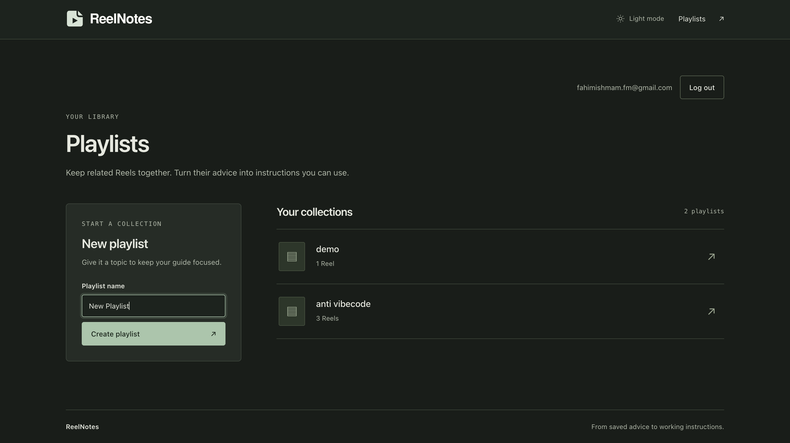
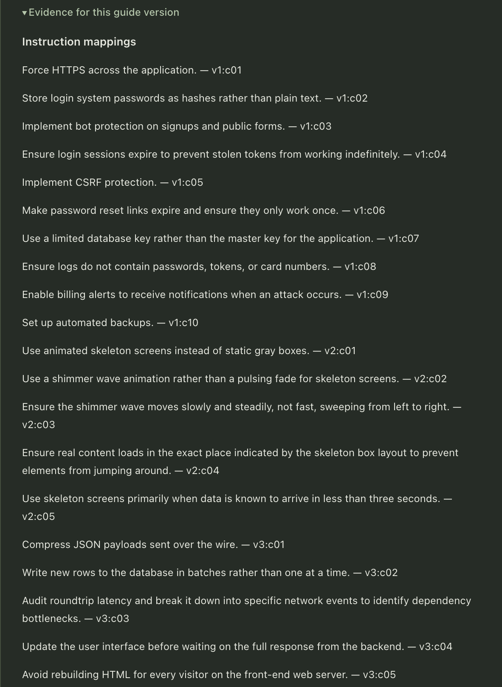

# ReelNotes

ReelNotes helps developers turn advice from public Instagram Reels into reviewable `AGENTS.md` guides backed by transcript evidence.


<!-- Add docs/screenshots/playlist-workspace.png, then uncomment the image below.

-->

> **Workspace screenshot placeholder** · `docs/screenshots/playlist-workspace.png`
>
> Capture a populated playlist with two or three processed Reels and the generated guide visible beside them.

## Contents

- [Features](#features)
- [Architecture](#architecture)
- [Screenshots](#screenshots)
- [Tech stack](#tech-stack)
- [Run locally](#run-locally)
- [Database requirements](#database-requirements)
- [Project scope](#project-scope)

## Features

**Personal library**

- Register and sign in to manage private playlists of up to 10 public Reels each.
- Reuse a processed Reel across your own playlists.

**Reel processing**

- Follow download, transcription, and advice extraction in the playlist workspace.
- Read timestamped transcripts and retry failed clips.

**Guide review and export**

- Generate a guide once the playlist is ready and browse saved versions.
- Open a saved guide’s evidence to trace instructions back to source clips and transcript excerpts.
- Download `AGENTS.md` or export the playlist as `playlist.json`. See the [example guide](examples/AGENTS.md) and [example manifest](examples/playlist.json).

## Architecture



1. **Queue.** FastAPI validates the Reel URL, checks playlist ownership, and inserts or reuses a video row in PostgreSQL. The browser can poll for progress while the worker runs.
2. **Process.** The worker claims a queued job with a renewable lease, downloads media with yt-dlp, and transcribes audio locally with faster-whisper. Gemini extracts claims from the transcript text.
3. **Generate.** On request, FastAPI sends playlist claims to Gemini for consolidation, validates the evidence references, and saves the Markdown and input snapshot. A saved version retains its source evidence when the playlist changes.

Entry points are the [FastAPI routes](api/app/main.py), [background worker](api/app/worker.py), and [guide pipeline](api/app/guide.py).

## Screenshots

Use PNGs in `docs/screenshots/`. After adding them, uncomment the image tags in this README and remove the placeholder captions. Use example data or crop out any real account email.

| Playlist library | Guide evidence |
| --- | --- |
| <!--  --> `docs/screenshots/playlist-library.png` | <!--  --> `docs/screenshots/guide-evidence.png` |
| Capture the home page with the new-playlist form and a few saved playlists. | Expand the evidence panel and capture an instruction alongside its linked claim and transcript excerpt. |

## Tech stack

| Area | Technology |
| --- | --- |
| Web | Next.js App Router, React, TypeScript |
| HTTP API and validation | FastAPI, Uvicorn, Pydantic |
| Authentication | PostgreSQL-backed cookie sessions, Argon2id via pwdlib |
| Database access | PostgreSQL, SQLAlchemy Core, psycopg |
| Media and speech | yt-dlp, FFmpeg, ffprobe, faster-whisper |
| Guide generation | Gemini via LangChain structured output |

## Run locally

**Prerequisites** · Python 3.11–3.13, uv, Node.js 20.9+, npm, PostgreSQL, FFmpeg and ffprobe, and a Google Gemini API key with access to your selected model. Set up the [database schema](#database-requirements) before starting the app.

### Install and configure

From the repository root:

```bash
(cd api && cp -n .env.example .env && uv sync)
(cd web && cp -n .env.local.example .env.local && npm ci)
```

| Setting | Where | Value |
| --- | --- | --- |
| `DATABASE_URL` | `api/.env` | Connection string for the PostgreSQL database with the `reelnotes` schema |
| `GOOGLE_API_KEY` | `api/.env` | Server-side Gemini API key |
| `GEMINI_MODEL` | `api/.env` | A Gemini model available to your key |
| `WEB_ORIGIN` | `api/.env` | Defaults to `http://localhost:3000` |
| `API_BASE_URL` | `web/.env.local` | Defaults to `http://127.0.0.1:8000` |

Keep credentials in `api/.env` and out of Git and browser-facing variables. The first transcription downloads the faster-whisper model weights.

### Start the three processes

Run each command in a separate terminal from the repository root.

**API**
```bash
cd api && uv run uvicorn app.main:app --host 127.0.0.1 --port 8000
```

**Worker**
```bash
cd api && uv run python -m app.worker
```

**Web**
```bash
cd web && npm run dev
```

Open [ReelNotes](http://localhost:3000) and register an account. The [interactive API reference](http://127.0.0.1:8000/docs) is available while FastAPI is running.

### Run checks

```bash
(cd api && uv run pytest)
(cd web && npm run typecheck && npm run build)
```

## Database requirements

Create the `reelnotes` schema before starting the app. The API uses [SQLAlchemy table mappings](api/app/db.py), and the database owner applies schema changes manually.

| Table | Columns and purpose |
| --- | --- |
| `accounts` | `id` identifies a user, `email` is unique, and `password_hash` stores the salted Argon2id hash. |
| `sessions` | `token_hash` is the primary key, `account_id` links to the user, and `expires_at` sets the session lifetime. |
| `playlists` | `id`, `owner_id`, `name`, and `created_at` identify and describe an account’s playlist. |
| `videos` | `id`, `owner_id`, `shortcode`, and `source_url` identify a Reel in an account. `title`, `creator`, `duration_ms`, and `thumbnail_webp` store media details. `state`, `attempts`, `lease_token`, `lease_until`, `error_code`, and `error_message` track processing. `segments`, `claims`, `pipeline_version`, `created_at`, and `updated_at` record its outputs and history. |
| `playlist_items` | `playlist_id` and `video_id` link a Reel to a playlist. `position` orders the items. |
| `guides` | `id`, `playlist_id`, and `input_hash` identify a saved version. `input_snapshot`, `result`, `markdown`, and `created_at` preserve the version and its evidence. |

- Use UUID identifiers and timezone-aware timestamps. Use JSONB for `segments`, `claims`, `input_snapshot`, and `result`, and `bytea` for `thumbnail_webp` and `token_hash`. Leave `segments` SQL `NULL` until transcription finishes.
- Enforce uniqueness on `(owner_id, shortcode)` and `(owner_id, source_url)` for videos, `(playlist_id, video_id)` and `(playlist_id, position)` for playlist items, and `(playlist_id, input_hash)` for guides.
- If upgrading an older single-user database, add account and session tables and owner columns first. Register the account that should own the legacy library, then assign the existing playlists and videos to it before requiring ownership. The migration queries are in Chapter 19 of the local project guide (`docs/REELNOTES_PROJECT_GUIDE.md`), which is kept outside Git.
- If the API uses a separate database role, grant it `SELECT, INSERT` on `reelnotes.accounts` and `SELECT, INSERT, DELETE` on `reelnotes.sessions`, alongside its existing permissions on the library tables.

## Project scope

- The source is on GitHub. Run the app locally to try it.
- Process public Reels you have permission to use. Speech recognition runs locally, and the resulting text is sent to Gemini for analysis.
- Review generated instructions against their evidence before using them in a coding project. The linked examples use authored fixture data.
